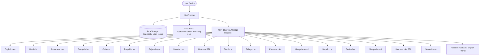

# KAAMSETU — PHASE 42 I18N ARCHITECTURE REPORT
## 18 Indian Languages Localization Infrastructure, Modular Dictionaries & RTL Engine

**Repository:** `Mayyank04/kaamsetu`  
**Classification:** `CLASS_B_CONTROLLED_ROLLOUT`  
**Permanent Financial Invariant:** `platform_commission_amount = 0.00` on artisan wages  

---

### 1. Architectural Overview

KAAMSETU implements a modular, high-performance internationalization system supporting **18 Indian languages** without heavy third-party runtime bundle overhead.

---

### 2. Supported Languages & Metadata Specification

| Code | Language Name | Native Script Name | Direction | Script Family | Primary Indian Region |
| :---: | :--- | :--- | :---: | :--- | :--- |
| `en` | English | English | `ltr` | Latin | Pan-India / Global |
| `hi` | Hindi | हिन्दी | `ltr` | Devanagari | North & Central India |
| `as` | Assamese | অসমীয়া | `ltr` | Bengali-Assamese | Assam / Northeast |
| `bn` | Bengali | বাংলা | `ltr` | Bengali | West Bengal / Northeast |
| `or` | Odia | ଓଡ଼ିଆ | `ltr` | Odia | Odisha / Eastern India |
| `pa` | Punjabi | ਪੰਜਾਬੀ | `ltr` | Gurmukhi | Punjab / Northern India |
| `gu` | Gujarati | ગુજરાતી | `ltr` | Gujarati | Gujarat / Western India |
| `mr` | Marathi | मराठी | `ltr` | Devanagari | Maharashtra / Western India |
| `ur` | Urdu | اردو | `rtl` | Nastaliq / Perso-Arabic | Pan-India / Northern / Deccan |
| `ta` | Tamil | தமிழ் | `ltr` | Tamil | Tamil Nadu / Southern India |
| `te` | Telugu | తెలుగు | `ltr` | Telugu | Andhra Pradesh & Telangana |
| `kn` | Kannada | ಕನ್ನಡ | `ltr` | Kannada | Karnataka / Southern India |
| `ml` | Malayalam | മലയാളം | `ltr` | Malayalam | Kerala / Southern India |
| `ne` | Nepali | नेपाली | `ltr` | Devanagari | Sikkim / North Bengal / Himalayan |
| `brx`| Bodo | बड़ो | `ltr` | Devanagari | Bodoland / Assam |
| `mni`| Manipuri | মৈতৈলোন্ | `ltr` | Bengali / Meitei Mayek | Manipur / Northeast |
| `ks` | Kashmiri | کٲشُر | `rtl` | Perso-Arabic | Jammu & Kashmir |
| `sa` | Sanskrit | संस्कृतम् | `ltr` | Devanagari | Pan-India Classical |

---

### 3. Key Architectural Invariants

1. **Zero Translation Key Leaks:**  
   If an individual key is missing from a regional dictionary, the `getTranslation` resolver automatically falls back to the English or Hindi equivalent. Users never see raw technical keys (e.g. `header.bannerTitle`).
2. **State & Form Data Isolation:**  
   Changing the platform language updates only interface display labels. Form state (such as entered name, phone number, and custom skills) is preserved in React state and `localStorage` without interruption.
3. **Persistent Preference:**  
   The selected locale is persisted to `localStorage` under `kaamsetu_user_locale` and restored automatically across browser reloads.
4. **Urdu and Kashmiri RTL Support:**  
   Selecting `ur` or `ks` dynamically updates `document.documentElement.dir = "rtl"`. The CSS grid and text alignments adapt seamlessly without layout breakdown.
